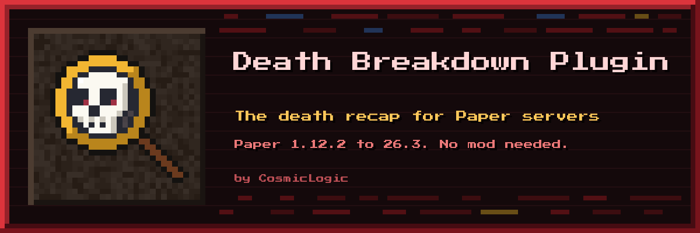
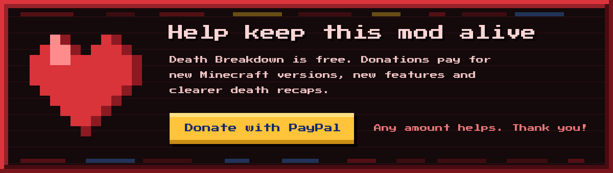

**See exactly what killed you, on a vanilla client.**

> ⚠️ **Requires [LogicLib Plugin](https://www.curseforge.com/minecraft/bukkit-plugins/logiclib-plugin).** Put it in your `plugins` folder too.

Your players die and all they get is "slain by Skeleton". This is the **server plugin version** of [Death Breakdown](https://www.curseforge.com/minecraft/mc-mods/death-breakdown): every death comes with a recap of the last 10 seconds, and **nobody has to install a mod**.

---

🧩 **Works on vanilla clients. Nothing to install on the player's side.**

## ▶️ How to use
1. Put **Death Breakdown Plugin** and **LogicLib Plugin** in your `plugins` folder and restart. No setup needed.
2. When a player dies, a one-line recap appears in their chat. They **hover [details]** for every hit, or **click [Open recap]** for the book.
3. `/db help` lists everything; `/db history` shows their last few deaths.

## 🔥 What it does

### 💬 A recap in chat
Right after dying, players get a one-line summary: who killed them, how much damage they took and what their armor and enchantments stopped. **Hover** any hit for the details.

### 📖 Or as a book
Click **[Open recap]** and the full recap opens as a book: one page per hit, final blow last. Nothing is added to the inventory. (On 1.12.2, which can't open books, the pages show in chat.)

### 🛡️ Armor and enchantments, separately
Every hit shows how much **armor** stopped and how much **enchantments** stopped, plus Resistance, absorption hearts and shields.

### 🔁 See it again
`/deathbreakdown` (or `/db`) reopens your last recap anytime.

### 📜 Your last few deaths *(new in 1.1.0)*
Each player's **last 5 deaths** are kept, even after they leave or the server restarts (`plugins/DeathBreakdown/history`). `/db history` lists them; click one to open it.

### 💡 A tip for every death *(new in 1.1.0)*
One short line in the hover and the book, like *"Lava did 80% of the damage."*

### 📋 Copy it *(new in 1.1.0)*
Click **[copy]** (or `/db copy`) to put the recap on your clipboard as text, for Discord or a bug report. Copy links need Minecraft 1.15+; on older servers `/db copy` prints the text instead.

### 👮 For staff *(new in 1.1.0)*
`/db player <name>` shows another player's last recap (permission `deathbreakdown.others`, ops by default).

### 💾 It remembers
Settings live in `plugins/DeathBreakdown/config.yml`: the time window, hearts or health points, chat on death, opening the book on respawn, which columns show, the tip line and how many deaths to keep. `/db reload` applies changes and tells you about any value it couldn't read.

| Command | What it does |
|---|---|
| `/db` | Your last recap as a book (in chat on 1.12-1.13) |
| `/db chat` | The chat summary again, with [details] |
| `/db history` | Your last deaths, click one to open it |
| `/db show <number>` | Open one from the history (1 = newest) |
| `/db copy` | Copy your last recap as text |
| `/db help` | All of this, in game |
| `/db player <name>` | Another player's last recap (`deathbreakdown.others`) |
| `/db reload` | Reload config.yml (`deathbreakdown.reload`) |

## 🆚 Plugin vs mod
The plugin gives the same recap in **chat and a book**. The mod adds the **recap screen** and the **K key**, but players have to install it.

## 📦 Requirements
- **Paper** (or a Paper fork): Minecraft 1.12.2, 1.16.5, 1.18.2, 1.19.2, 1.20.1, 1.21.1, 1.21.11, 26.1, 26.2 and 26.3. One jar for all of them.
- **Requires [LogicLib Plugin](https://www.curseforge.com/minecraft/bukkit-plugins/logiclib-plugin)** (shared code for my plugins). The plugin won't start without it.
- Server only. Players don't need anything.

Source and bug reports: https://github.com/CosmicLogic0/deathbreakdown-plugin

---

## ❤️ Support the plugin

Death Breakdown is free. Donations keep it up to date with fixes, new Minecraft versions and new features. [Donate with PayPal](https://www.paypal.com/paypalme/DylanEMason) - any amount helps. Thank you!

---

🎮 Want to see it in action? Come play on **Logic Survival** (`play.logicsurvival.fyi`), the survival server run by the maker of this plugin.
